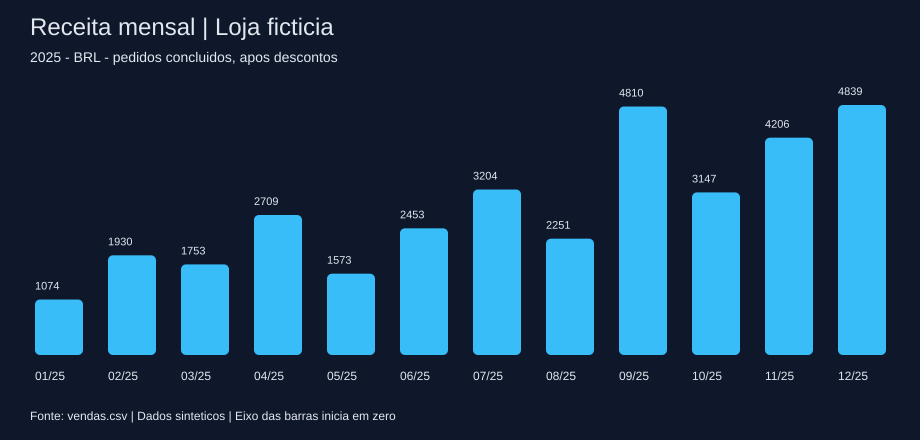

# Analise de vendas de uma loja

**Python · Analise exploratoria · Indicadores de negocio · Visualizacao**

Projeto de portfolio com dados **inteiramente ficticios**, criados para estudo.
Investiga quais produtos e meses concentram receita e acompanha cancelamentos.



## Como executar

Requer Python 3.10 ou superior. Nao ha dependencias externas.

```bash
python analise.py
```

Execute dentro da pasta do projeto. No Windows, `py analise.py` tambem funciona quando o Python Launcher esta instalado.
O script le `vendas.csv` e recria `RESULTADOS.md` e o grafico SVG. Os resultados ja estao incluidos para consulta.

## Perguntas

- Qual a receita apos descontos e o ticket medio?
- Quais produtos lideram a receita?
- Como a receita varia ao longo dos meses?
- Qual a proporcao de pedidos cancelados?

## Dados e definicoes

300 pedidos de janeiro a dezembro de 2025; cada linha representa um pedido com um unico produto.
Base sintetica gerada com semente 42: o numero de pedidos cresce de forma programada durante o ano.

| Coluna | Definicao |
|---|---|
| pedido_id | Identificador unico do pedido |
| data | Data do pedido, AAAA-MM-DD |
| produto / categoria | Nome e grupo do produto |
| quantidade | Unidades do pedido |
| preco_centavos | Preco por unidade em centavos de real |
| desconto_centavos | Desconto total do pedido em centavos |
| status | concluido ou cancelado |

Receita = quantidade × preco − desconto, apenas nos pedidos concluidos.
Ticket medio = receita / pedidos concluidos. Valores monetarios sao somados em centavos inteiros.
A analise nao considera impostos, custos, frete ou devolucoes; portanto nao mede lucro.

## Descobertas

Consulte [os resultados calculados](RESULTADOS.md), com indicadores, participacao dos produtos e acoes sugeridas.
A variacao mensal nao demonstra sazonalidade real nem permite conclusoes causais.

## Proximos passos

Incluir custos para medir margem e comparar volume versus ticket medio por mes.

Licenca: MIT.
